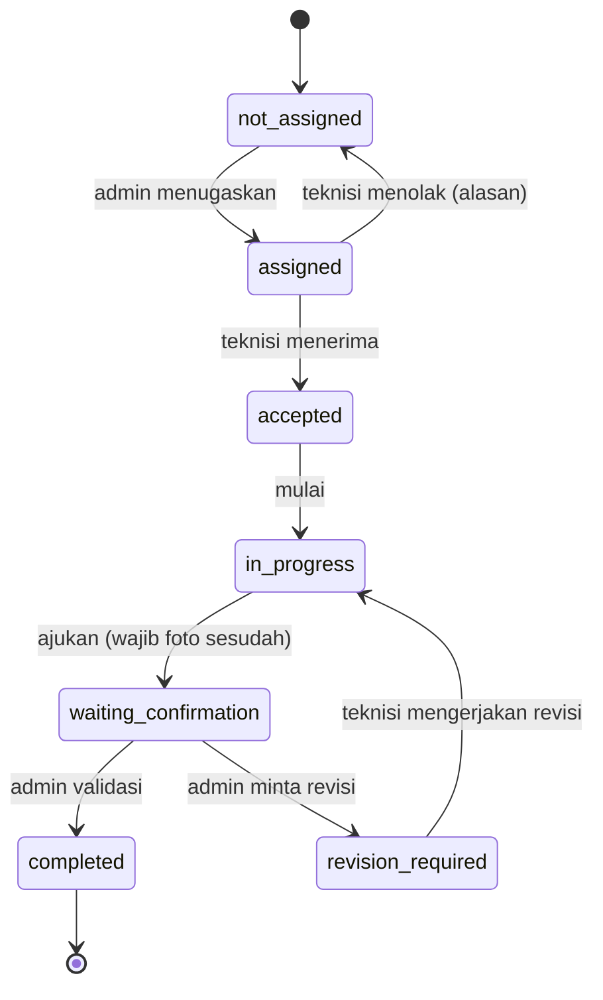
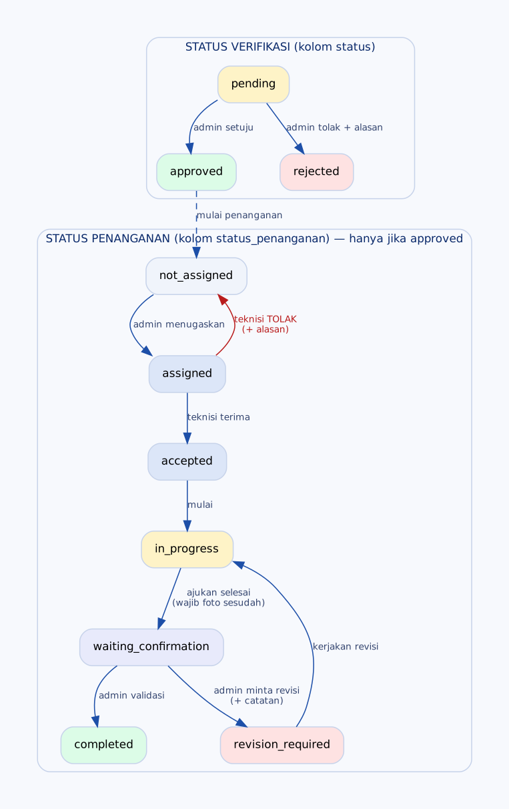
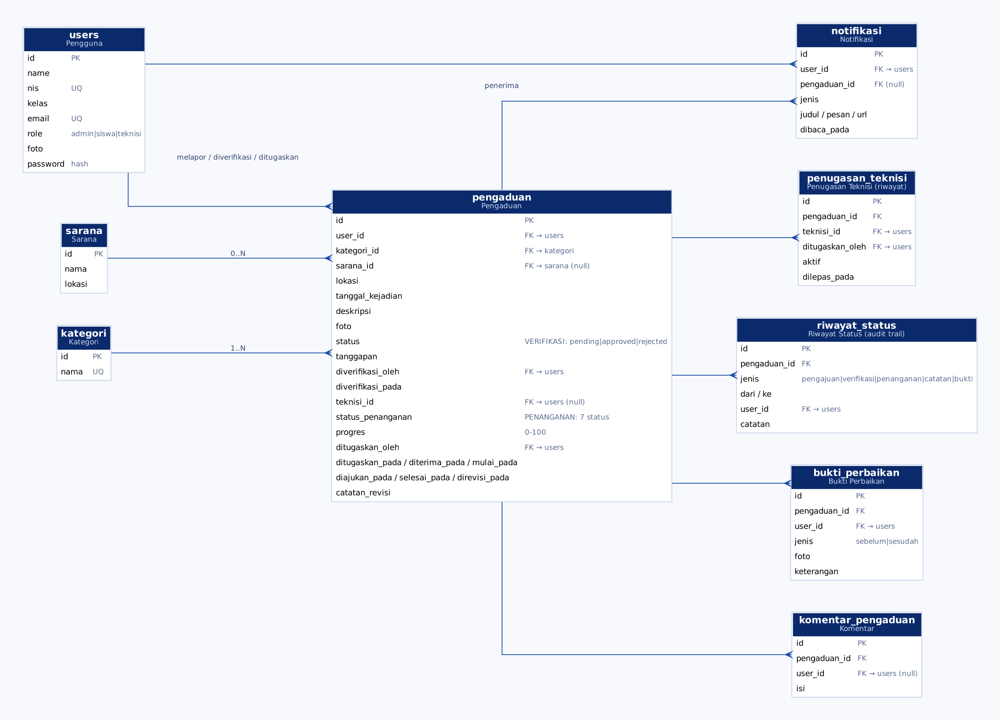

# Dokumentasi Teknis — ADUKANAJA

**Sistem Pengaduan & Pemeliharaan Sarana Sekolah** — siswa melaporkan kerusakan, admin memverifikasi dan menugaskan teknisi, teknisi memperbaiki dan melaporkan hasilnya, admin memvalidasi.

## 1. Teknologi
| Lapisan | Teknologi |
|---|---|
| Backend | PHP 8.2+, **Laravel 12** (MVC + *service layer*) |
| Frontend | Blade, CSS murni (design system sendiri), JavaScript ringan (tanpa framework) |
| Database | MySQL/MariaDB (SQLite untuk pengujian otomatis) |
| Autentikasi | Laravel Auth (session), password di-hash bcrypt |
| Font | Inter (di-host lokal, lisensi SIL OFL) |
| Pengujian | PHPUnit — **173 test** |

## 2. Peran & hak akses
| Fitur | Admin | Siswa | Teknisi |
|---|:-:|:-:|:-:|
| Kelola pengguna, sarana, kategori | ✔ | | |
| Mengajukan pengaduan + foto | | ✔ | |
| Melihat pengaduan | semua | milik sendiri | yang ditugaskan |
| Verifikasi (setujui/tolak + alasan) | ✔ | | |
| Menugaskan teknisi | ✔ | | |
| Terima / **tolak** tugas | | | ✔ |
| Progres, catatan, unggah / **hapus** foto bukti | | | ✔ |
| Ajukan penyelesaian | | | ✔ |
| Validasi hasil / minta revisi | ✔ | | |
| Komentar pada pengaduan | ✔ | ✔ (miliknya) | ✔ (tugasnya) |
| Notifikasi | ✔ | ✔ | ✔ |
| Laporan, ekspor Excel, cetak | ✔ | | |

Pembatasan dilakukan **di backend**: middleware `role:*` pada seluruh route, `PengaduanPolicy` untuk akses per-objek, dan query yang dibatasi pada pemilik (mencegah IDOR). Pengujian otomatis memindai *seluruh* route terhadap guest dan ketiga role.

## 3. Alur status
Dua status yang **terpisah**: `status` (verifikasi) dan `status_penanganan`.

```
status (verifikasi):   pending ──► approved | rejected

status_penanganan:     not_assigned ──► assigned ──► accepted ──► in_progress ──► waiting_confirmation ──► completed
                            ▲              │                          ▲                   │
                            └── ditolak ───┘            revision_required ◄── minta revisi ┘
```



Semua perubahan status melewati satu kelas, **`App\Services\PengaduanWorkflow`**, yang: (1) mengunci baris dalam transaksi, (2) memeriksa pelaku & kepemilikan, (3) memeriksa transisi yang diizinkan (`Pengaduan::TRANSISI`), (4) menyimpan perubahan, (5) mencatat **riwayat_status** (audit trail) dan (6) membuat notifikasi — semuanya atomik. Request HTTP tidak dapat mengubah status secara langsung.

## 4. Database


Catatan: seluruh kolom `user_id` / `*_oleh` pada tabel anak merujuk ke `users`. Aturan integritas: hapus pengaduan → riwayat, bukti, komentar, notifikasi ikut terhapus (*cascade*); hapus teknisi/admin → referensi menjadi `NULL` (jejak audit tetap ada); kategori yang dipakai tidak dapat dihapus (*restrict*). Semua migration bersifat **aditif dan idempotent** (aman untuk data lama) dan migration FASE 3 mengisi riwayat dari data lama.

## 5. Keamanan
- Autentikasi session, password bcrypt, pembatasan percobaan login (10/menit), pesan login gagal tidak membocorkan keberadaan akun
- CSRF pada semua form, output di-*escape* (XSS), validasi server-side di setiap form
- Otorisasi berlapis (middleware role + policy + query terbatas pemilik); anti-IDOR; anti-*mass assignment*
- Upload: hanya JPG/PNG/WEBP, batas ukuran, nama file diacak, file `.php` ditolak
- Header keamanan (`X-Frame-Options`, `nosniff`, `Referrer-Policy`, `Permissions-Policy`, HSTS di HTTPS)
- Transaksi + penguncian baris pada proses penting; tautan notifikasi hanya internal (anti *open-redirect*)
- Perintah Artisan: `adukanaja:cek-keamanan`, `adukanaja:acak-password-demo`, `adukanaja:ganti-password`, `adukanaja:buat-admin`

## 6. Struktur folder penting
```
app/Services/PengaduanWorkflow.php     ← satu-satunya pintu perubahan status
app/Services/NotifikasiService.php     ← pembuat notifikasi
app/Policies/PengaduanPolicy.php       ← otorisasi per-objek
app/Http/Controllers/{Admin,Siswa,Teknisi}/ …
app/Console/Commands/                  ← perintah keamanan/operasional
resources/views/{layouts,components,admin,siswa,teknisi,notifikasi,auth}/
public/css/{app,login,fonts}.css · public/fonts/inter · public/img
database/migrations · database/seeders
tests/Feature/                         ← 14 berkas, 173 test
```

## 7. Pengujian
`php artisan test` — 173 test: fitur bawaan, struktur proyek (aman di Linux), role teknisi, setiap transisi workflow, tampilan, **matriks otorisasi otomatis seluruh route**, keamanan (XSS, CSRF, upload, throttle), validasi semua form, integritas database & **migrasi data lama**, notifikasi, komentar, tolak tugas/hapus bukti, kesiapan produksi. Pengujian tampilan/responsif dilakukan di Chromium pada lima lebar layar (360–1920 px) dan lewat checklist di `docs/TESTING.md`.

## 8. Batasan & pengembangan lanjutan
- Notifikasi in-app (belum email/WhatsApp); komentar belum mendukung lampiran
- Belum ada pencarian/filter lanjutan pada notifikasi dan komentar
- Penugasan satu teknisi per pengaduan (riwayat tersimpan, belum multi-teknisi)
- Pengujian otomatis berjalan di SQLite; perilaku khusus MySQL diuji manual
